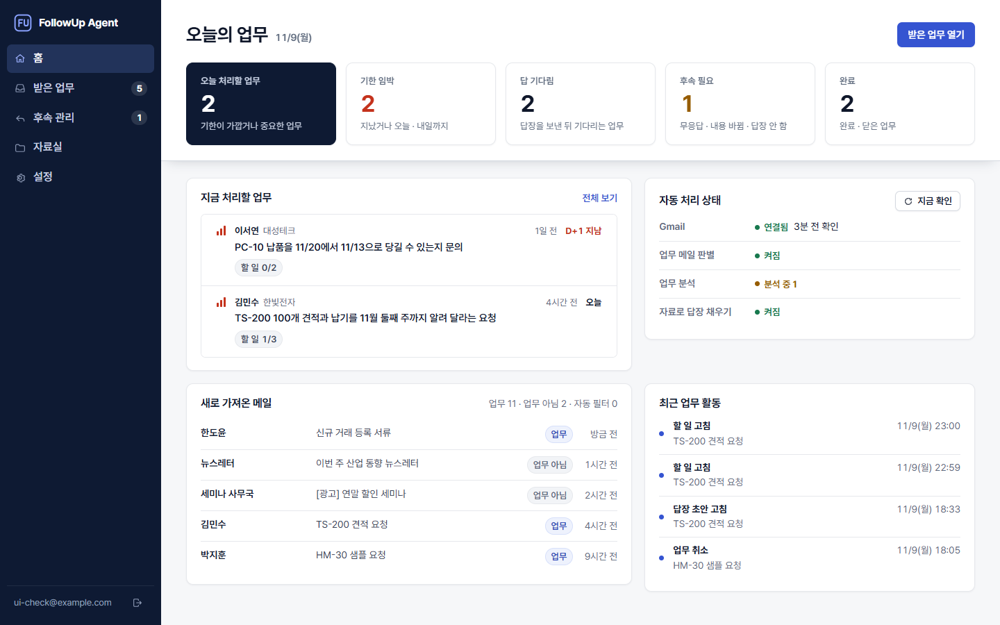
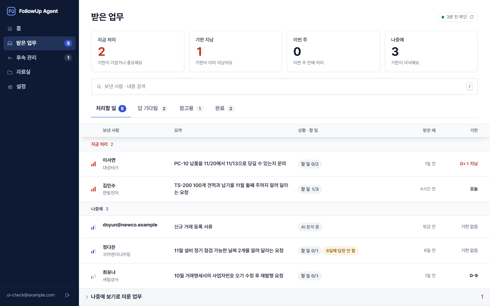
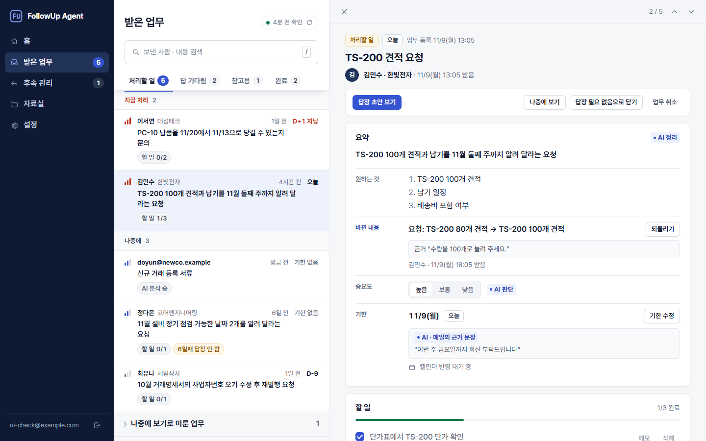
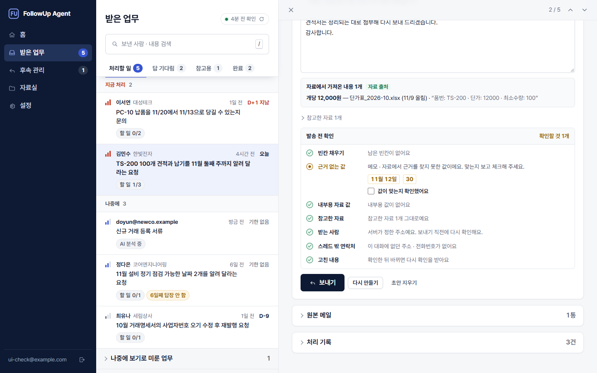
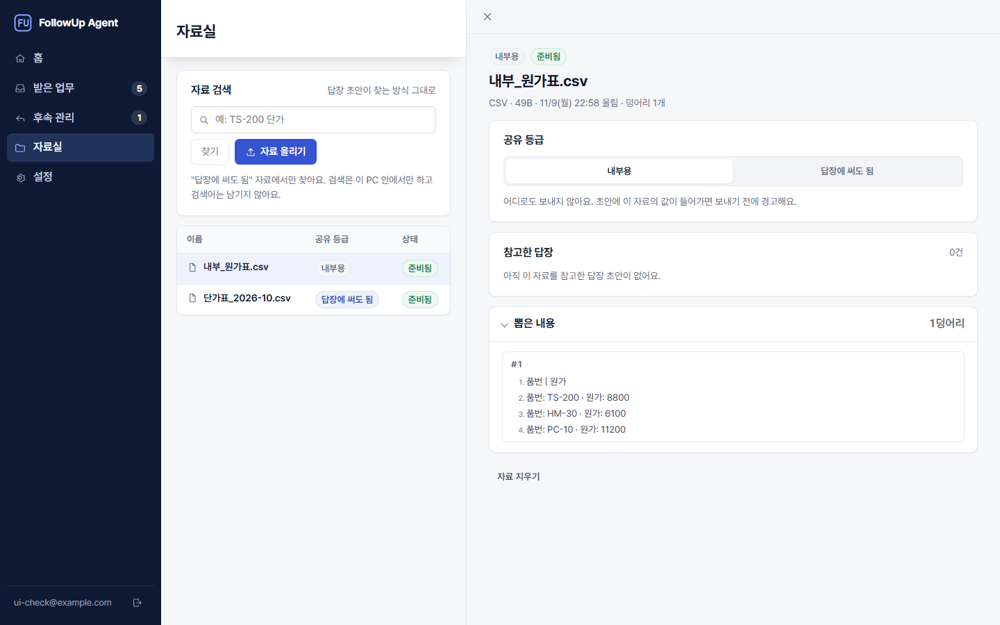
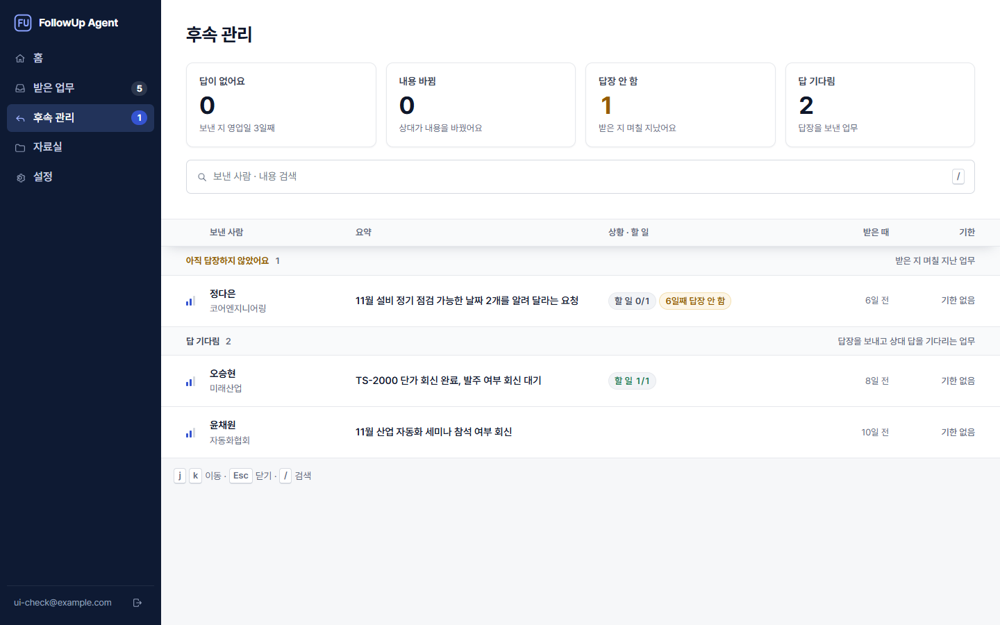
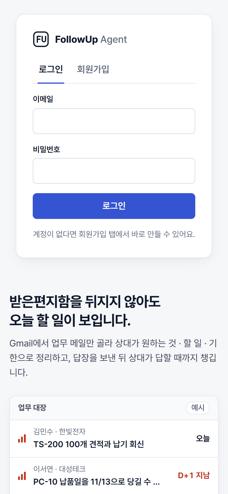
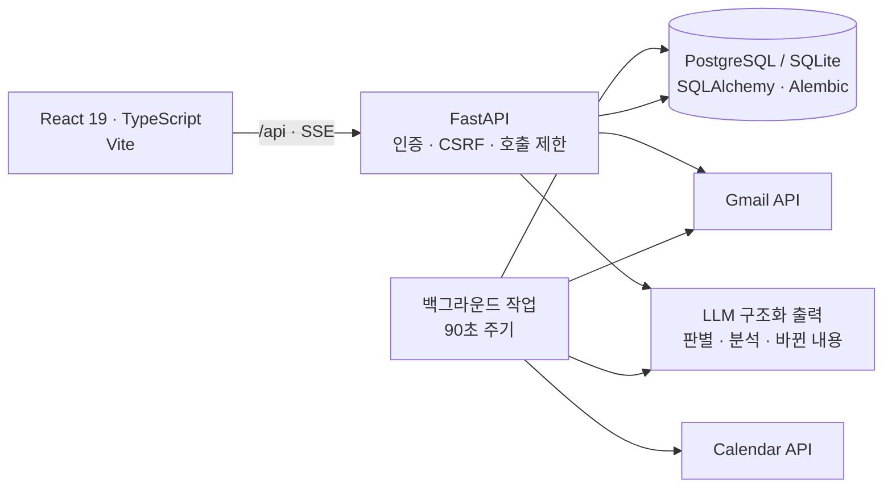

# FollowUp Agent

**메일 한 통이 끝난 업무가 되기까지 챙기는 업무 메일 Agent.**
Gmail 받은편지함에서 업무 메일만 골라 요약 · 할 일 · 기한으로 정리하고, 기한은 Google 캘린더에 올리고,
근거가 있는 값만 채운 답장 초안을 **사람이 확인해야만** 보냅니다. 보낸 뒤에는 상대가 답하지 않거나 내용을 바꾸면 알려 줍니다.



`Python` `FastAPI` `SQLAlchemy` `Alembic` `PostgreSQL / SQLite` `React 19` `TypeScript` `Vite` `Gemini / Claude 구조화 출력` `Gmail · Calendar API` `SSE` `GitHub Actions`

> 개인 포트폴리오 프로젝트입니다. 화면의 데이터는 모두 가상 예시(`.example` 주소, 가상 회사 · 품번)이고, 실제 Gmail · 캘린더 연동은 단계마다 본인 계정으로 확인했습니다.

---

## 해결하는 문제

견적 · 납기 · 샘플 메일을 하루 수십 통 주고받는 영업 · 구매 담당자는 **메일을 읽는 것보다 놓치지 않는 것**이 어렵습니다.
누가 무엇을 언제까지 원하는지, 내가 답했는지, 상대가 답을 안 하는지, 중간에 수량을 바꾸지 않았는지를 사람이 기억해야 합니다.

FollowUp Agent는 이 흐름을 한 줄로 이어 줍니다.

```
받은 메일 → 업무 판별 → 요약 · 할 일 · 기한(근거 문장) → 캘린더 → 답장 초안 → 발송 전 확인 → 보내기
          → 답 기다림 → 상대가 바꾸면 근거와 함께 반영 · 영업일 3일 무응답이면 다시 연락
```

## 화면

| 받은 업무: 고르기 전엔 전체 폭 목록 | 업무 상세: AI 판단과 근거 문장 |
|---|---|
|  |  |
| **발송 전 확인: 근거 없는 값 · 내부용 값 · 받는 사람** | **자료실: 답장에 써도 됨 / 내부용** |
|  |  |

<details>
<summary>후속 관리 · 휴대폰 화면</summary>




</details>

## 주요 기능

- **업무 메일 판별:** 이미 업무인 스레드 → 규칙 필터(광고 · 자동 알림) → LLM 순으로 걸러 비용과 오판을 줄입니다.
- **업무 정리:** 한 줄 요약 · 상대가 원하는 것 · 할 일 · 기한. 기한 옆에 메일의 근거 문장을 붙이고, "이번 주 금요일" 같은 상대 날짜는 코드가 사용자 시간대로 다시 계산합니다.
- **AI 값과 사람 값 구분:** AI가 정한 값은 "AI 판단", 사용자가 고친 기한 · 중요도는 "직접 정함"으로 표시하고, 다시 분석해도 덮어쓰지 않습니다.
- **캘린더:** 기한을 비공개 일정으로 올리고, 바뀌면 고치고, 끝나면 표시합니다.
- **답장 초안 + 발송 전 확인:** 메모 · 입력 · 스레드 메일 · "답장에 써도 됨" 자료에 있는 값만 쓰고, 근거가 없으면 `[[ ]]` 빈칸으로 남깁니다.
- **후속 관리:** 영업일 3일 무응답, 받고 48시간 답장 안 함, 상대가 내용을 바꿈을 모아 보여 주고 다시 연락 초안을 만듭니다.
- **재답장 반영:** 상대가 "수량을 100개로"라고 다시 보내면 80개 → 100개를 근거와 함께 보여 주고 반영 · 되돌리기를 고르게 합니다.
- **자료실(RAG 1단계):** 단가표 · 정책 문서를 올리면 초안을 만들 때 관련 줄만 찾아 쓰고, 초안이 인용한 줄과 숫자를 코드로 다시 확인합니다.
- **실시간 · 키보드:** 업무 상세는 SSE로 실시간 갱신, `j` `k` `Esc` `/` `?` 단축키, 휴대폰 대응.

## 안전 설계: 되돌릴 수 없는 일은 사람이, 확인은 서버가

메일 발송은 되돌릴 수 없어서, 화면의 확인과 서버의 검사를 **같은 규칙으로 두 번** 합니다.

| 위험 | 막는 방법 |
|---|---|
| AI가 받는 사람을 바꾼다 | 받는 사람은 LLM이 아니라 서버가 그 스레드의 메일 기록에서 정하고, 보내기 직전에 다시 계산해 다르면 거절(409) |
| 근거 없는 숫자 · 날짜가 나간다 | 초안 속 숫자 · 날짜를 근거 글과 토큰 단위로 비교. "30만 원" = "300,000원"처럼 단위까지 맞춰 비교하고, 근거가 없으면 "값이 맞는지 확인했어요"를 체크해야 보냄 |
| 내부 원가가 새어 나간다 | 내부용 자료의 값이 초안에 있으면(“8만 8천 원”처럼 써도) "알고 보냅니다"를 체크해야 보냄. 내부용 자료는 LLM으로 보내지 않음 |
| 확인한 뒤 초안이 바뀐다 | 확인 체크를 초안 버전(`updated_at`)에 묶어, 그사이 바뀌면 거절하고 다시 확인 |
| 메일 속 지시문(프롬프트 주입) | 메일 · 자료 본문은 격리 태그로 감싸 데이터로만 보내고, 정규식으로 탐지해 보안 경고로 남김. 의심 덩어리는 검색에서 제외 |
| 두 번 보내기 | 보내는 중 · 결과 불분명 상태를 따로 두고, 불분명하면 5분 뒤 보낸편지함 확인을 물음. 이미 답장했으면 거절 |
| 개인정보가 로그에 남는다 | 로그 · 처리 기록에는 메일 번호 · 건수 · 예외 이름만. DB 오류 메시지에서도 값을 숨김(`hide_parameters`). 전 과정을 돌려 확인하는 테스트 |
| 실제 메일이 의도치 않게 LLM으로 | 실제 메일을 LLM에 보내는 기능은 모두 스위치(`MAIL_TRIAGE_ENABLED`, `KNOWLEDGE_ENABLED`) 뒤, 기본 꺼짐 |

그 밖에 사용자별 데이터 격리(남의 업무는 존재 여부도 404), CSRF 헤더 검사, 외부 호출 API 호출 제한, Google 갱신 토큰 AES-GCM 암호화를 적용했습니다.

## 구조



- **백엔드 모듈:** `mail/`(동기화 · 판별 · 접수 · 재답장 · 합치기 · 초안 · 발송 · 캘린더), `knowledge/`(글 뽑기 · 덩어리 · 검색 · 출처 확인), `google/`(OAuth · 클라이언트 · 토큰 암호화), `agent/`(LLM 호출 · 주입 탐지 · 처리 기록)
- **LLM 결과는 믿지 않습니다.** 판별 · 분석 · 초안은 JSON 스키마 구조화 출력 1회 호출이고, 날짜 · 근거 문장 · 숫자는 코드가 다시 확인합니다. 형식이 틀린 응답만 횟수를 세고, 제공자 장애는 다음 주기에 다시 합니다.
- **외부 서비스는 프로토콜 뒤에.** 테스트는 가짜 Gmail · 가짜 LLM으로 네트워크 없이 돕니다.

## 품질

- **백엔드 테스트 747개**(48개 파일), GitHub Actions CI에서 백엔드 테스트와 프론트 빌드 · lint를 돌립니다.
- **실제 LLM 스모크 테스트**는 가상 데이터로 opt-in(`RUN_LLM_SMOKE=1`).
- **정확도 측정:** [답장 · 업무 생애](docs/evals/2026-10-27-reply-lifecycle.md), [자료 검색 · 자료로 채운 초안](docs/evals/2026-10-29-rag-documents.md)(키워드 검색 recall@5 0.81).
- **설계 → 계획 → 구현:** 기능마다 [설계 문서와 구현 계획](docs/superpowers/)을 쓰고, 계획과 달라진 점은 계획 문서의 변경 이력 표에 남겼습니다.

## 판단 기록에서 몇 가지

전체는 [docs/decisions.md](docs/decisions.md)에 있습니다.

- **답장은 앱에서 승인해야 발송.** 자동 발송은 범위에서 뺐습니다. 편의보다 "사람이 누르지 않으면 아무것도 나가지 않는다"를 택했습니다.
- **근거 없는 값은 확인해야 보낸다.** 처음 설계는 경고만 했지만, 사용성 검토에서 "근거 없는 숫자가 거래처로 나가는 것"을 가장 심각한 문제(P0)로 꼽아 확인 체크를 해야 보내도록 바꿨습니다. 숫자 형식 차이로 생기는 오탐이 있을 수 있어 완전 차단 대신 확인으로 풀 수 있게 했습니다.
- **임베딩 대신 키워드 검색부터.** 품번 중심 자료에서 키워드 검색을 측정(recall@5 0.81)해 보고, 의미 검색은 측정 결과와 비용(무료 등급 데이터 정책)을 보고 정하기로 했습니다.
- **메일 상대 주소록(`contacts`)은 만들지 않음.** 답장 받는 사람은 메일 기록에서 정하므로, 주소를 한 번 더 저장해 개인정보만 늘리는 테이블은 빼기로 했습니다.

## 로컬 실행

```bash
python -m venv .venv && .venv/Scripts/pip install -r backend/requirements-dev.txt   # mac/linux: .venv/bin/pip
cp .env.example backend/.env                                                          # LLM 키 · SECRET_KEY 입력
cd backend && ../.venv/Scripts/alembic upgrade head && ../.venv/Scripts/uvicorn app.main:app --port 8000
cd frontend && npm install && npm run build                                           # http://localhost:8000
cd backend && ../.venv/Scripts/python -m pytest -q                                    # 테스트(오프라인)
```

Google 연결(OAuth 클라이언트 만들기), 기능 스위치, 자료실 사용법, 배포 방법은 [개발 기록과 실행 가이드](docs/development.md)에 있습니다.

## 문서

[개발 기록과 실행 가이드](docs/development.md) · [판단 기록](docs/decisions.md) · [데이터 · 개인정보 흐름](docs/privacy.md) · [변경 이력](CHANGELOG.md) · [설계 · 구현 계획](docs/superpowers/) · [제품 기준](PRODUCT.md) · [디자인 체계](DESIGN.md) · [문제 해결](docs/troubleshooting.md)

**범위 밖(의도적으로 제외):** 회사 메일(Gmail 외) 연동, 사용자 승인 없는 자동 발송, 모델 학습, 결제, 모바일 앱.
